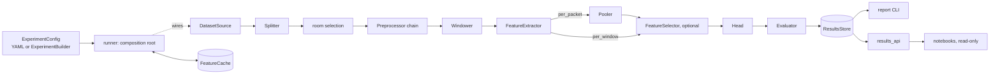
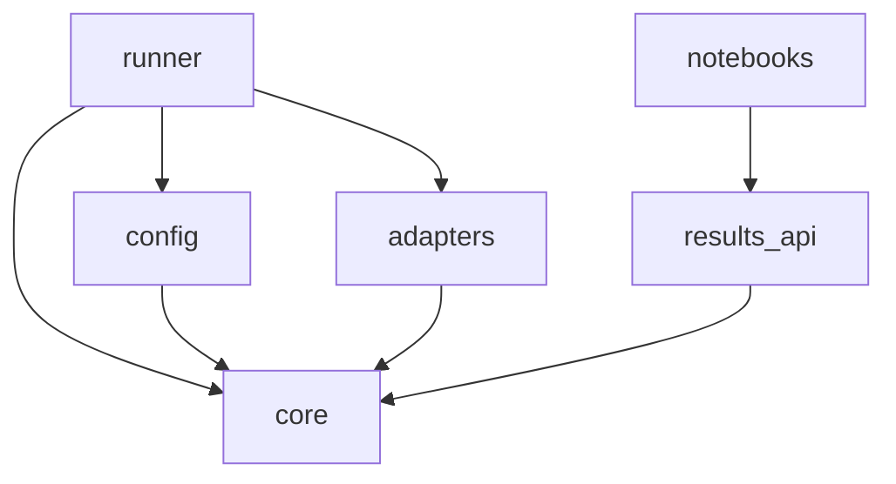
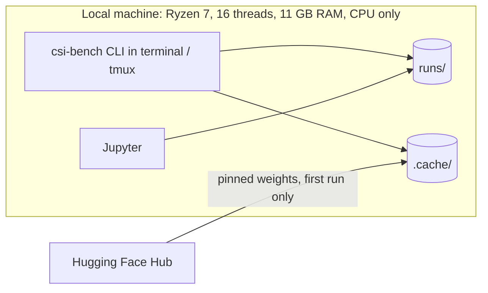

# Architecture Spine — csi-bench

## Design Paradigm

The pipeline follows the **pipes-and-filters** pattern:

- Each stage is a **port** (a `typing.Protocol`).
- Each port has interchangeable **adapters**, which register themselves in a **registry** and are selected by name.
- A single **composition root** (`runner/`) turns a validated `ExperimentConfig` into a concrete pipeline.
- Data moves between stages only as immutable contracts.
- Preprocessing math, windowing, pooling and metrics are pure functions. I/O happens only in `DatasetSource`, `FeatureCache` and `ResultsStore` adapters.



| Layer | Package | Holds |
| --- | --- | --- |
| Core | `csi_bench.core` | Contracts, ports, registry, errors, results schema, pure functions (windowing, pooling math, metrics, hashing) |
| Adapters | `csi_bench.adapters.<stage>` | One module or package per implementation |
| Config | `csi_bench.config` | pydantic models, YAML loader, `ExperimentBuilder`, sweep expander |
| Runner | `csi_bench.runner` | Composition root, adapter discovery, sweep execution, CLI (`describe`, `run`, `sweep`, `report`) |
| Results API | `csi_bench.results_api` | Read-only queries over the results store, using the core results schema |

## Invariants & Rules



### AD-1 — Stages and their ports are fixed

- **Binds:** all
- **Prevents:** per-model scripts, and stages that call each other directly
- **Rule:**
  - The pipeline has exactly these ports: `DatasetSource`, `Splitter`, `PreprocessStep`, `Windower`, `FeatureExtractor`, `Pooler`, `FeatureSelector`, `Head`, `Evaluator`, `FeatureCache`, `ResultsStore`.
  - A new capability is a new adapter behind an existing port.
  - Adding a port is a spine amendment.

### AD-2 — Dependency direction

- **Binds:** all
- **Prevents:** hidden coupling that blocks replacing or removing a component
- **Rule:**
  - Imports follow the diagram above. `core` imports no other project module.
  - An adapter imports only `core` and its own `_vendor/`, never another adapter.
  - Only `runner` imports adapter modules, and it does so by discovering them, never by naming each class.
  - Notebooks import only `results_api`.
  - Enforced by `import-linter` contracts, plus a test that scans `notebooks/*.ipynb` imports.

### AD-3 — Adapters register themselves, with typed params and a version

- **Binds:** all adapters, `config`, `runner`
- **Prevents:** if/else selection chains, configs found invalid mid-run, and code changes that go unnoticed
- **Rule:**
  - Each adapter registers itself with `@register("<stage>", "<name>")` from `core/registry.py`.
  - The runner discovers adapters by importing `csi_bench.adapters` with `pkgutil.walk_packages`. Adding an adapter means adding its module; deleting the module removes it.
  - Each adapter declares a pydantic `Params` model and an integer `VERSION`. `VERSION` is bumped whenever a code change can change its output.
  - Params whose values don't affect results (`batch_size`, `threads`, `device`) are marked `affects_result=False`.
  - All params are validated before any stage runs.

### AD-4 — Immutable data contracts with fixed shapes

- **Binds:** all stages
- **Prevents:** stages that disagree on axis order, label coding, index meaning, identifiers or metadata
- **Rule:** Stages exchange only frozen dataclasses defined in `core/contracts.py`.

  **`Recording`**
  - `csi`: complex64 array, axes `(antennas, packets, subcarriers)`.
  - `antenna_ids`: the original receiver antenna index of each row.
  - `recording_id`: `"<dataset>/<path relative to the dataset root, without extension>"`.
  - `room` and `label`.
  - `meta: RecordingMeta`: `n_packets`, `downsample_factor | None`, `sample_rate_hz | None`, `source_sha256`. Only the `DatasetSource` fills it.

  **Labels**
  - Each `DatasetSource` declares its ordered class list, and labels are indices into that list.
  - `tor_vergata` uses `0 empty, 1 sitting, 2 standing, 3 walking`.
  - Metrics key per-class scores by class name, not by index.

  **Packet indices**
  - 0-based and end-exclusive, into the packet axis as the `DatasetSource` delivers it.
  - No later stage reorders, drops or resamples packets. Resampling or cleaning is a `DatasetSource` variant (an option such as `equalize_rate`).

  **`window_id`** is `"<recording_id>@<start>:<end>"`.

  **Other contracts**
  - `SplitPlan`.
  - `WindowSet`: `window_id`, `recording_id`, `start`, `end`, `split ∈ {train, val, test}`, ordered by `(recording_id, start)`.
  - `PacketFeatures`: float32 `(n_packets, d)` per recording, row-aligned to packet index.
  - `FeatureMatrix`: float32 `(n_windows, d)`, row-aligned to `WindowSet`, with `feature_names` (one unique name per column, prefixed by family, e.g. `amplitude_stats.mean_power`).
  - `Predictions` and `Metrics`.

  Contracts are never mutated. A stage returns a new object.

### AD-5 — An experiment is a serializable config

- **Binds:** `config`, `runner`, every run
- **Prevents:** runs that can't be traced, two construction paths that drift apart, and sweep files that expand differently
- **Rule:**
  - The runner accepts only an `ExperimentConfig`. YAML files and `ExperimentBuilder.build()` both produce one, and neither constructs pipeline objects.
  - `run_id` is the hash of the canonical, fully resolved config, plus the `VERSION` of every adapter it uses and the hash of each `_vendor/` folder it uses. It excludes `seeds` and every `affects_result=False` param.
  - The resolved config is saved with every result. `csi-bench run runs/<run_id>/config.yaml` reproduces the same `run_id`, and a test checks this.
  - Sweeps use an explicit `sweep:` block that maps dotted paths to value lists. The expander takes their Cartesian product. Everything outside `sweep:` is literal. `seeds` cannot be swept.
  - `role ∈ {comparison, reference}` is a required config field.

### AD-6 — The Splitter alone owns train/val/test assignment

- **Binds:** CAP-1, CAP-3 to CAP-7
- **Prevents:** leakage across the split, splits that differ per model or per room setting, and silent re-splitting
- **Rule:**
  - The primary splitter, `time_block`, assigns contiguous packet blocks of every recording to `train`, `val` and `test`.
  - Adjacent blocks are separated by `gap_packets`, a committed split param (initial value 64). A window longer than `gap_packets` raises `ConfigError`. Raising `gap_packets` is a deliberate new split version.
  - The split covers all recordings of a dataset once. Room settings (r1, r2, mixed) are a later `selection` filter (AD-17), never a different split.
  - The `SplitPlan` is committed at `splits/<dataset>/<split_hash>.json` together with the `source_sha256` of every input.
  - The split never depends on model, preprocessing, pooling, window length or selection. A splitter's own randomness comes from a seed in its params.
  - If any class has no `val` or `test` windows, the splitter raises `DataError`.
  - Exception: `random_window`, which assigns individual windows at random (`unit: window`), is valid only when `role: reference` (AD-16).

### AD-7 — The Windower alone owns window boundaries

- **Binds:** CAP-3, CAP-5, CAP-7, all extractors and poolers
- **Prevents:** windows straddling train/val/test, extractors reading outside their window, and models scored on different windows
- **Rule:**
  - `window_len` and `stride` are counted in packets. The default stride is 1.
  - Each window lies entirely inside one split block.
  - The runner gives an extractor only the packet slice `[start, end)` of each window.
  - An extractor declares `min_window_len`. `window_len = 1` is valid only for per-packet extractors.
  - Extractors and poolers never create, drop or shift windows. A window an extractor can't process makes the run fail.
  - For a given `(split_hash, selection, window_len, stride)`, every model sees the same `window_id`s.

### AD-8 — Extractor granularity, purity and pooling

- **Binds:** `FeatureExtractor`, `Pooler`
- **Prevents:** re-running an extractor for every window length, outputs that depend on batching, and test statistics leaking through an extractor
- **Rule:**
  - Each extractor declares:
    - `granularity: per_packet | per_window`
    - `requires: {phase: bool, n_antennas: int | "any"}`, which the runner checks during config validation
  - Extractors are pure per input: processing a window alone gives the same features as processing it in a batch, and they compute no statistics across windows.
  - **Per-packet extractors** (LWM) return `PacketFeatures`. LWM's `embedding: cls | channel_mean` param selects the CLS token or the mean of the channel tokens. A `Pooler` (`mean`, `mean_std`, …) reduces each window's packets to one vector. Poolers have no trainable weights.
  - **Per-window extractors** (WavesFM, Mantis, ImageNet, and classical feature families such as `paper_beamforming` and `amplitude_stats`) return a `FeatureMatrix`, and their config must set `pooler: null`.
  - **Classical features are registered as families.** A family computes all of its features for a window in one pass and returns named columns; adding a feature means adding one function to its family. A run may list several families, and the runner concatenates their columns.
  - Models are run in `eval()` mode under `torch.inference_mode()`. A contract test checks that parameter checksums are unchanged after extraction.
  - After each extraction, the runner checks that features are finite and that no dimension is constant, and raises `ExtractorError` if either check fails.

### AD-9 — Preprocessing is an ordered chain of fitted steps

- **Binds:** `PreprocessStep` adapters, all extractors
- **Prevents:** model-specific formatting leaking into shared preprocessing, statistics computed on test data, and chains that differ by order
- **Rule:**
  - Preprocessing is an ordered list of `PreprocessStep`s. Each step has `fit(train recordings, plan) → state` and a pure `transform(recording, state)`. Its hash covers the list order.
  - Named presets in `config/presets.py` cover the spec's variants: global rescale, per-packet power, either of those plus phase sanitization, and amplitude-only.
  - Steps operate per packet, or run separately within each split block. Fitted state comes from the selected `train` blocks only and is written to provenance.
  - Antenna selection is the step `antennas: [ids]`. The 2-antenna variant is `[0, 1]`, which matches `processing.py`.
  - Model-specific input formatting stays inside the extractor: LWM 4×4 patching, image resize, fixed ImageNet normalization constants, and the Mantis channel layout.
  - Normalizations that need recording-level statistics are `PreprocessStep`s, never extractor params. `recording_mean_norm` (the paper's `norm = 1`) divides each antenna by its mean amplitude, fitted on that recording's `train` block.

### AD-10 — The feature cache has one client and complete keys

- **Binds:** `FeatureCache`, `runner`, extractors
- **Prevents:** stale cached features, two components reading and writing the cache, and collisions between settings
- **Rule:**
  - Only the runner reads and writes `FeatureCache`. Extractors never touch it.
  - The cache key hashes `{dataset, split_hash, selection, preprocessing chain + fitted-state hash, extractor name + params affecting results + VERSION + _vendor hash + weights revision}`. Per-window keys add `window_len` and `stride`.
  - Writes are atomic (temp file, then rename).
  - Deleting `.cache/features` never changes a result.

### AD-11 — Heads never see test data before scoring

- **Binds:** `Head`, `Evaluator`, CAP-3 to CAP-7
- **Prevents:** tuning on the test set, and each head carving validation data its own way
- **Rule:**
  - One head family is shared by all feature sources: `logreg`, `svm`, `knn`, `random_forest` and `mlp`.
  - A head receives `fit(train, val)`. It selects hyperparameters on `val`, then refits on train ∪ val. It never carves its own validation set.
  - Feature scaling is fitted inside the head.
  - Test windows are predicted once, after the head is fitted.
  - A single `Evaluator` (pure functions in `core`) computes accuracy, macro-F1, per-class scores and the confusion matrix for both `val` and `test`.

### AD-12 — Seeds, device and determinism

- **Binds:** heads, any stochastic adapter, `runner`
- **Prevents:** results that vary between reruns of the same `run_id`, and adapters choosing their own device
- **Rule:**
  - `config.seeds` drives training randomness only. A run executes once per seed, writes to `runs/<run_id>/seeds/<seed>/`, and records mean ± std.
  - If a requested seed is missing from a `done` run, only that seed is executed.
  - The runner sets `device = "cpu"`, the torch thread count and the determinism flags, and records them. Adapters never set them.
  - Vendored code must not touch global RNGs. LWM's `make_sample` is never called.

### AD-13 — Results store, provenance and report

- **Binds:** `ResultsStore`, `runner`, `report`, `results_api`, notebooks
- **Prevents:** untraceable results, two readers of the store disagreeing on its layout, picking variants by test score, and thesis numbers produced in notebooks
- **Rule:**
  - **Run directory.** Each run writes `runs/<run_id>/{config.yaml, status.json, metrics.json, seeds/<seed>/predictions.parquet, provenance.json, run.log}`.
  - **Provenance** records:
    - the git commit, a dirty flag, and the diff when dirty
    - package versions
    - `split_hash`, cache keys and weights revisions
    - fitted preprocessing state
    - LWM input amplitude statistics, which document the domain gap
    - duration
  - **Schemas.** The paths and schemas of all files and of `runs/index.parquet` are defined once in `core/results_schema.py`. Both `ResultsStore` and `results_api` use it.
  - **`csi-bench report`** is the only producer of the CAP-5 table:
    - Rows are methods (extractor + head). Columns are selections (r1, r2, mixed).
    - Each cell shows the variant with the best **validation** macro-F1 and reports that variant's test score.
    - `--all-variants` lists every variant.
    - The report refuses to mix `split_hash`es in one table.
    - It reads published numbers from `experiments/published_reference.yaml` and prints each row's regeneration command.
    - It excludes dirty runs by default.
  - **Notebooks** compute nothing reported in the thesis.

### AD-14 — Sweeps are resumable and failures are isolated

- **Binds:** `runner`
- **Prevents:** a crash losing finished work, one bad config aborting a queued sweep, and dirty runs leaving permanent holes in the table
- **Rule:**
  - `status.json` moves `pending → running → done | failed`, and a failed run records its error trace.
  - A sweep skips `done` runs. On a clean tree, it reruns `done` runs that were recorded with `dirty: true`.
  - A failure never stops the sweep.
  - Runs execute one at a time in one process. `--force` reruns a run regardless of its status.

### AD-15 — Third-party model code stays inside its adapter

- **Binds:** LWM and WavesFM extractors, and any future research-code model
- **Prevents:** research code's formats, dependencies and loading bugs spreading through the project
- **Rule:**
  - **What to vendor.** Research code that isn't installable as a package is copied into `adapters/extractors/<model>/_vendor/`. Copy only the model definition plus the input-formatting functions inference needs (e.g. LWM `patch_maker`), with no training, data or DeepMIMO code. Only that adapter imports it.
  - **Recording the copy.** `_vendor/SOURCE.md` records the source URL, the full commit sha, every local edit, and the model constructor arguments. `_vendor/` is excluded from ruff and ty.
  - **Weights.** Fetched with `huggingface_hub` at a pinned full sha into `.cache/weights/` (git-ignored), and loaded with `map_location="cpu"`.
  - **Loading checks.** Key remapping is done explicitly in the adapter: LWM strips the `module.` prefix, and WavesFM maps `vis_patch_embed.0.*` to `vis_patch_embed.*`. A contract test asserts that, apart from head keys, no keys are missing and none are unexpected.
  - **Packaged models.** Mantis (`mantis-tsfm`) and ImageNet models (`timm`) are ordinary dependencies, imported only in their adapter, with weight revisions pinned.
  - **Isolation limits.** No git submodules, and no separate virtualenvs unless a dependency conflict forces one, which would be a spine amendment.

### AD-16 — The paper method is recomputed, and its random split is reference-only

- **Binds:** CAP-5, the `paper_beamforming` extractor
- **Prevents:** treating the paper's leaky random-split numbers as a like-for-like comparison, and a reference path that bypasses the pipeline
- **Rule:**
  - `processing.py`'s features are ported as the `paper_beamforming` per-window extractor, run on `tor_vergata`. Its `fix_distance_loop` param defaults to `false`, which keeps the original behaviour. It has no `norm` param: the paper's `norm = 1` is the `recording_mean_norm` step (AD-9).
  - Only with `role: reference`, `recording_mean_norm` may use `fit_scope: whole_recording`, which reproduces the paper exactly. Config validation rejects that scope for `role: comparison`.
  - Port correctness is tested against a verbatim copy of `processing.py`'s per-window computation in `tests/oracles/` (with a source note), because `processing.py` is a script with no importable functions. `processing.py` itself is never modified.
  - Run with `random_window` and `role: reference`, it reproduces the paper. Run with `time_block` and `role: comparison`, it joins the comparison.
  - `saved_dataset/*.npy` is used only as a test fixture that checks the port.
  - `report` shows reference rows separately, next to the published numbers.

### AD-17 — Selection decides which recordings are scored, after splitting

- **Binds:** `runner`, `report`, CAP-3, CAP-5
- **Prevents:** room settings producing different splits or window ids, and nobody owning the r1/r2/mixed choice
- **Rule:**
  - `selection: {rooms: [...]}` is a top-level config field, applied after the split.
  - `r1`, `r2` and `mixed` are each a selection over the same `SplitPlan`. Each one is a separate run.
  - Fitted preprocessing state and heads use only the selected recordings.
  - `csi-bench describe <dataset>` writes per-recording packet counts and per-class, per-room and per-split counts to `runs/_dataset/<dataset>.parquet`. `report` includes that table, which serves as the rate-confound guard.

### AD-18 — Feature selection is a fitted step that never sees test

- **Binds:** `FeatureSelector`, `Head`, CAP-4, CAP-5
- **Prevents:** selection tuned on test data, and selections that cannot be traced or compared
- **Rule:**
  - The config field is `feature_selection`, distinct from the room `selection` of AD-17. It runs between the features (or pooler) and the head. Options: `null` (all columns), `manual` (a list of column names or families), or an automatic selector (`mrmr` first).
  - A selector receives only the train and val parts of the `FeatureMatrix`: it is fitted on train, and its settings (e.g. how many features) are chosen on val together with the head's hyperparameters. Test columns are filtered with the fitted choice.
  - Selection only picks columns. Features are never recomputed per subset, so the feature cache serves every subset.
  - Each run records the selected `feature_names` per seed. `report` shows how stable the selection is across rooms and seeds.
  - Selection is `null` by default for pretrained-model embeddings.

## Consistency Conventions

| Concern | Convention |
| --- | --- |
| Naming | The package is `csi_bench`. Registry names are `snake_case` and match the module name (`lwm`, `wavesfm`, `mantis`, `imagenet`, `paper_beamforming`, `amplitude_stats`, `mrmr`, `time_block`, `random_window`, `mean_std`, `random_forest`). |
| Ids & hashes | Hashes are SHA-256 of canonical JSON (sorted keys, no whitespace), shown as the first 12 hex characters. `window_id` follows AD-4. |
| Data formats | Features are `.npy`, tables `.parquet`, configs YAML and metadata JSON. Timestamps are UTC ISO-8601. |
| Sweep files | Use an explicit `sweep:` block of dotted paths (AD-5). Standard window sweep: `window_len ∈ {1, 10, 30, 40, 50}` (40 = the paper's W2). |
| Errors | Adapters raise `core.errors` (`ConfigError`, `DataError`, `ExtractorError`). The runner catches them at the run boundary and records them. Nothing else catches broadly. |
| Logging | stdlib `logging`, with one logger per module. No `print` in library code. |
| Memory & disk | Extractors process inputs in batches and never hold all inputs at once (11 GB RAM). `.cache/` and `runs/` can be regenerated. Back up `runs/index.parquet` and the runs behind the thesis table. |
| Code quality | `ruff` and `ty` must pass, excluding `_vendor/`. Every port has a contract test that each of its adapters runs. |
| Builder | `ExperimentBuilder.build()` returns an `ExperimentConfig` and nothing else. |

## Stack

| Name | Version |
| --- | --- |
| Python | 3.12 |
| uv | 0.12.23 |
| torch / torchvision (CPU index via `tool.uv.sources`) | 2.14.1+cpu / 0.29.1+cpu |
| numpy | 2.5.3 |
| scikit-learn | 1.9.1 |
| pandas (uv `override-dependencies`, because mantis-tsfm caps it at <3 but never imports it) | 3.0.6 |
| pyarrow | 25.0.1 |
| pydantic | 2.13.5 |
| PyYAML | 6.0.3 |
| huggingface-hub | 2.1.1 |
| timm (exact pin: WavesFM imports private `timm.models._manipulate`) | 1.0.30 |
| mantis-tsfm | 1.1.0 |
| mrmr-selection (same MRMR as `classification.py`; pulls polars 2.0.0, category-encoders 2.11.1) | 0.2.8 |
| LWM v1.1 code + weights | HF `wi-lab/lwm-v1.1` @ `1b68512dbe97de56841301206eacb780fcd76011` |
| WavesFM weights | HF `ahmedaboulfo/wavesfm` @ `6a63011e7cbc4ea05ec664d02643e7330c9cc503` |
| WavesFM code | GitHub `AhmedTarek62/wavesfm` @ `0279d3b11afd7691f2565a8361a5d0d60b3ae363` |
| Mantis-8M weights | HF `paris-noah/Mantis-8M` @ `bc7d5ab40c02133386a28e2c127f35c17c86901d` |
| ruff | 0.16.10 |
| ty (beta) | 0.0.84 |
| import-linter | 2.15 |
| pytest | 9.1.1 |

## Structural Seed

```text
master/
  pyproject.toml            # uv project; CPU torch index; pandas override; ruff, ty, import-linter config
  src/csi_bench/
    core/                   # contracts, ports, registry, errors, results_schema, windowing, pooling, metrics, hashing
    adapters/
      datasets/             # tor_vergata.py
      splitters/            # time_block.py, random_window.py
      preprocess/           # antennas.py, rescale.py, power_norm.py, phase_sanitize.py, amplitude_only.py
      extractors/           # lwm/, wavesfm/ (each: adapter.py + _vendor/), mantis.py, imagenet.py, paper_beamforming.py, amplitude_stats.py
      poolers/              # mean.py, mean_std.py
      selectors/            # manual.py, mrmr.py
      heads/                # logreg.py, svm.py, knn.py, random_forest.py, mlp.py
      storage/              # feature_cache.py, results_store.py
    config/                 # models.py, presets.py, loader.py, builder.py, sweep.py
    runner/                 # discover.py, compose.py, execute.py, cli.py
    results_api/
  experiments/              # *.yaml sweeps, published_reference.yaml
  splits/                   # committed SplitPlan JSON
  notebooks/                # read-only analysis
  tests/                    # contract tests per port, import contracts, regeneration test
  data/csi_proc_python/     # existing dataset + professor scripts, unchanged
  .cache/                   # features/, weights/ (git-ignored)
  runs/                     # results store (git-ignored)
```



There is a single environment, the local machine, with no services. The only runtime network access is the first download of each pinned set of weights.

## Capability → Architecture Map

| Capability | Lives in | Governed by |
| --- | --- | --- |
| CAP-1 Load own dataset with fixed splits | `datasets/tor_vergata`, `splitters/time_block`, `splits/`, `describe` | AD-4, AD-6, AD-17 |
| CAP-2 LWM embeddings (CLS + channel) | `extractors/lwm`, `preprocess/*` | AD-8, AD-9, AD-10, AD-15 |
| CAP-3 Evaluate LWM as-is | `poolers/*`, `heads/*`, `core/metrics` | AD-7, AD-8, AD-11, AD-12, AD-17 |
| CAP-4 Classical ML: feature library + selection + classifiers | `extractors/{paper_beamforming, amplitude_stats, …}`, `selectors/*`, `heads/*` | AD-4, AD-8, AD-11, AD-18 |
| CAP-5 Comparison table + paper reference | `report`, `extractors/paper_beamforming`, `splitters/random_window` | AD-13, AD-16, AD-17 |
| CAP-6 Public datasets | new `datasets/<name>` adapters | AD-1, AD-3, AD-4 |
| CAP-7 Other pretrained models | `extractors/{wavesfm, mantis, imagenet}` | AD-8, AD-15 |
| Domain-gap finding | LWM provenance stats, `report --all-variants` | AD-9, AD-13 |

## Deferred

| Item | Why it can wait |
| --- | --- |
| Trainable aggregators (attention, sequence heads) | They go behind `Head` (AD-8). Add them once the frozen pooling results are in. |
| Wrapper feature selection (forward selection with the classifier) | Expensive and prone to overfitting validation with 19 recordings. Add after manual subsets + MRMR, behind AD-18. |
| Training deep networks end-to-end (CNNs on raw CSI, fine-tuning) | Out of scope for now. Needs a new trainable-model port that reuses the split, windows, evaluator and results store. |
| Public dataset loaders (Padova, WiMANS, EHUNAM) | Pending supervisor verification. Each is a `DatasetSource` with its own class list. |
| Sample-rate equalization | Only if the professor confirms the rates differ. It would be a `tor_vergata` variant (AD-4). |
| Parallel run execution | Not needed: queued sequential sweeps fit the workflow. Revisit if a sweep doesn't finish overnight. |
| Experiment-tracking UI (e.g. MLflow) | `index.parquet` and notebooks are enough for now. A UI could be added later as a second `ResultsStore` adapter. |
| GPU / cloud execution | CPU only per the spec. Revisit in the fine-tuning phase. |
| ImageNet backbone choice | Pick it when the story is built, then pin its weights revision in the Stack (AD-15). |

## Open Questions

| Question | Owner | Blocks |
| --- | --- | --- |
| Does the supervisor accept the time-block split, `gap_packets = 64` and the window strategy? | Jj → supervisor | Final thesis numbers, not the build |
| Which data-cleaning steps does Paolo want? Each becomes a `PreprocessStep` | Paolo | Nothing (non-blocking) |
| Do the saved recordings share one sample rate? | Professor | Rate-equalization check |
| Licenses: the LWM HF repo declares none, and the WavesFM repo has no license file | Jj → authors | Publishing the code |
| Watch-list model weights (AM-FM, CSI-JEPA, …) | Jj → authors | Adding those models to CAP-7 |
